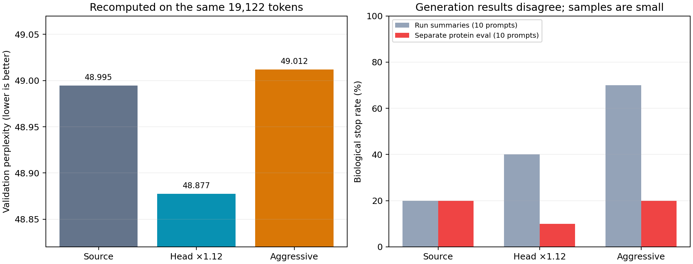
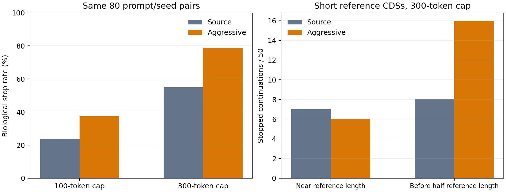

# Weight-space edit audit (10 November 2026)

## Verdict

The conservative edit improves teacher-forced validation perplexity by 0.117 PPL (0.24%); its paired 100-token generation gain is small and uncertain. The aggressive edit worsens PPL by 0.017, but a new paired generation test finds **more biological stops** at a 300-token cap: 63/80 versus 44/80. Those stops are often **premature** relative to the source CDS, and adjacent codon repetition increases slightly. Neither edit should be promoted on stop rate alone.

The right panel juxtaposes two *different* small evaluations. It is evidence of uncertainty, not a paired comparison. “Source” is the unedited primary checkpoint; the conservative checkpoint is sourced from the multi-offset run, whose next-token weights give the same validation result in this audit.

## What actually changed

| Checkpoint | Source recorded in checkpoint metadata | Verified tensor changes | Parameters changed |
| --- | --- | --- | ---: |
| `corrected-weight-space-programming-seed1337` | `corrected-multi-offset-heads-seed1337` | `head.weight` multiplied by 1.12 | 26,112 |
| `corrected-aggressive-weight-space-programming-seed1337` | `corrected-codonlm-v1-batch64-lr-ablation-lr_1_5e4` | `head.weight` ×1.10 plus stop-token row steering; columns 48:96 of `blocks.8.attn.proj.weight` ×0.70 and `blocks.9.attn.proj.weight` ×0.85 | 62,976 distinct scalar entries |

I loaded each source and edited `best.pt` and compared every tensor exactly. The conservative checkpoint has 196 model tensors, of which only the head differs. The aggressive checkpoint has 176 tensors, of which only the three listed tensors differ. Its 62,976 count includes 26,112 head entries and 18,432 entries in each attention projection. No gradients were needed to produce either checkpoint. Both source heads have the same SHA-256 prefix (`bd2cba303ff703c3`), but the full checkpoints have different auxiliary heads.

The conservative `summary.md` states the multi-offset source, while the matching `corrected-primary-weight-space-programming-seed1337` run has an almost identical summary with the *primary* source. These should not be conflated when comparing generation. The aggressive script's “edited_tensors” list repeats `head.weight` for two operations; it describes four operations on three tensors.

## Teacher-forced validation

I evaluated the first 50 rows of `val_bs512.npz`, in order, with `best.pt`, `model.eval()`, unsmoothed cross-entropy and target ID 0 ignored. Every model was scored on the same 19,122 target tokens.

| Model | NLL (nats/token) | PPL | Δ PPL from its source |
| --- | ---: | ---: | ---: |
| Multi-offset source | 3.891711 | 48.9946 | — |
| Conservative edit | 3.889315 | 48.8774 | **−0.1172** |
| Primary source | 3.891711 | 48.9946 | — |
| Aggressive edit | 3.892064 | 49.0120 | **+0.0173** |

These reproduce the summaries to their stated precision. The validation subset is small and appears to be the subset used to choose the edits. The older source `scores/metrics.json` values are from a different, much larger test evaluation and cannot be compared directly with these validation numbers. The conservative run's `scores/metrics.json`, training curves and generation protocol CSVs are inherited artifacts: the generation manifests name the unedited multi-offset source checkpoint. They are **not evaluations of the edited checkpoint**. The aggressive run contains no `scores/` evaluation artifacts.

## Generation evidence and limitations

The two edited run summaries report natural biological stop rates of 40% and 70%, respectively, against 20% for the unedited source, at a 100-token cap. Those are 4/10 and 7/10 observations, so one sequence moves the rate by 10 percentage points. The summaries do not supply prompt IDs, generated sequences, random seeds, or per-sequence stop reasons to verify the comparisons.

A separate file, `runs/_summary/wsp_protein_eval_corrected_critic.json`, reports 20% for the primary source, 10% for the **primary** head-only edit (a different checkpoint from the requested conservative run), and 20% for the requested aggressive edit. Its script, `scripts/eval_protein_prediction_scores.py`, uses ten test genes and does not set a sampling seed. The opposing aggressive results (70% versus 20%) therefore need a paired rerun. Its critic scores and amino-acid identities are exploratory, small-sample diagnostics, not evidence of biological function.

The generation code records `had_terminal_stop` only for `TAA`, `TAG`, or `TGA`. It stops separately on `<EOS_CDS>`. Consequently “natural stop rate” omits EOS endings, while “hard-cap rate” includes neither EOS nor biological-stop endings. Record all three outcomes separately. Mean generated length is also shortened by premature stops, so a shorter mean cannot be counted as an improvement without a reference length distribution.

The proposed layer 8/9 “CTG self-copy circuit” and the claim that head scaling corrects under-confidence are hypotheses in the summaries. The tensor audit establishes what was edited, not that those mechanisms caused the observed behavior. In particular, adding `alpha * ln_f.bias / ||ln_f.bias||²` to stop-token rows yields a context-dependent logit shift, not a constant stop prior. Combining stop codons and EOS can improve stopping counts while producing incomplete coding sequences.

The linked [weight-space programming article](https://rikiyat.github.io/blog/weight-space-programming/) supports the general idea of direct, reasoned weight edits. Its examples do not validate this particular circuit diagnosis or biological outcome.

## New paired generation and sequence-quality tests (10 November 2026)

I ran `python -m scripts.eval_weight_space_programming` on 40 frozen held-out test CDSs, balanced 20/20 by genome, with two fixed sampling streams per CDS. All checkpoints received the same three-codon prefix, unrestricted temperature 1.0 sampling, and the same pre-drawn uniform random value at each generation step. This is paired by prompt and sampling stream. The 100-token run includes both edited checkpoints and their recorded sources; a 300-token follow-up compares the primary source with the aggressive edit. The first ten prompts overlap earlier exploratory work, so this is a controlled replication, not a wholly untouched final test.

| Model / cap | Biological stop | EOS | Hard cap | Mean generated codons | Mean GC | Adjacent repeat rate |
| --- | ---: | ---: | ---: | ---: | ---: | ---: |
| Multi-offset source / 100 | 19/80 (23.8%) | 0 | 61/80 | 91.6 | 52.2% | 2.52% |
| Conservative / 100 | 21/80 (26.3%) | 0 | 59/80 | 88.2 | 52.5% | 2.94% |
| Primary source / 100 | 19/80 (23.8%) | 0 | 61/80 | 91.6 | 52.2% | 2.52% |
| Aggressive / 100 | 30/80 (37.5%) | 0 | 50/80 | 79.7 | 50.6% | 3.51% |
| Primary source / 300 | 44/80 (55.0%) | 0 | 36/80 | 211.0 | 51.8% | 2.49% |
| Aggressive / 300 | 63/80 (78.8%) | 0 | 17/80 | 161.2 | 50.4% | 3.44% |

At 100 tokens, the conservative paired stop-rate change is +2.5 percentage points (prompt-cluster bootstrap 95% interval −12.5 to +16.3; 18 pairs gained a stop, 16 lost one). The aggressive change at 100 is +13.8 points (interval −1.3 to +28.8). At 300 tokens, its gain is +23.8 points (interval +8.8 to +37.5; 28 gained, 9 lost; exact paired discordance test p=0.0026). The longer cap materially changes the apparent termination performance.

The 40 source CDSs average 349 codons (median 268). Among the 50 trajectories with a reference continuation no longer than 300 codons, the aggressive edit gives **6** biological stops within 75–125% of reference continuation length, versus **7** for the source. Stops before half the reference length rise from **8 to 16**. Across all stopped trajectories, median generated length falls from 145 to 106 codons and median generated/reference length ratio from 0.57 to 0.40. The edit increases stopping, but this test does **not** show better termination timing.

Simple sequence checks show no internal biological stop before the final sampled stop (the raw decoder ends at the first stop). Non-codon special tokens occurred in 3/80 source and 1/80 aggressive trajectories at 300 tokens; EOS did not occur. Mean GC moves from 51.8% to 50.4%, compared with 52.8% in the source CDSs. Codon-distribution Jensen–Shannon distance from those source CDSs is 0.131 (source) versus 0.136 (aggressive), base-2 units; this is a slight worsening. Adjacent codon repetition rises by 0.95 percentage points (prompt bootstrap interval +0.02 to +2.40 points). These are sequence diagnostics, not protein function or fitness measurements.

I also translated the 300-token continuations and ran the corrected ProteinCritic checkpoint on them and on the 40 source proteins. Two aggressive continuations were shorter than the five-amino-acid scoring threshold, leaving 78 paired comparisons. Predicted MegaScale ΔG averages 1.738 kcal/mol for source-model generations, 1.752 for aggressive generations, and 1.729 for source proteins. The paired aggressive-minus-source prediction difference is +0.014 kcal/mol (prompt-bootstrap 95% interval −0.007 to +0.034), so this critic does not show a stability gain. Mean family top-1 confidence is 0.0987 versus 0.0985; mean function top-1 confidence is 0.3234 versus 0.3209. These nearly flat confidence values do not establish function or fold quality. The scores are saved in `runs/_summary/weight_space_paired_eval_300/critic_scores.json`.

Raw paired trajectories, source IDs and settings are in `runs/_summary/weight_space_paired_eval/` and `runs/_summary/weight_space_paired_eval_300/`. The runnable benchmark is `scripts/eval_weight_space_programming.py`. It preserves the same sampling uniforms across models, but uses batched inverse-CDF sampling rather than `torch.multinomial`; therefore its exact counts need not match older unseeded scripts. All model comparisons *within* each new run share the same procedure.

## How to push further

1. **Re-establish the baseline with a paired benchmark.** Use at least 200 held-out CDS prefixes balanced by genome and length, several fixed sampling seeds per prefix, the same token-level random draws across checkpoints, unrestricted sampling at temperature 1.0, and a 300-token cap. Include both source checkpoints and both requested edits. Report confidence intervals clustered by source CDS, biological-stop, EOS and hard-cap rates, length distributions, and stop position relative to the reference CDS. The existing generation diagnostics show that temperature and top-k can change stopping substantially; keep decoder settings fixed and report them.
2. **Ablate each edit.** On a frozen development set, sweep head scales around 1.0–1.15, stop steering strength including zero, and each attention-head factor independently. Select a Pareto candidate using validation NLL, calibrated termination timing, internal-stop rate, repetition and GC drift. Confirm once on an untouched test set. A stronger stop rate alone is not the objective.
3. **Measure termination calibration directly.** At held-out real terminal positions and earlier positions, compare stop/EOS probabilities, ranks and positional hazard. Verify that probability rises near true ends rather than everywhere. Check whether head deflation reduces repeated codons without damaging next-token prediction.
4. **Prefer a targeted correction if the circuit is real.** A length-aware or termination-specific adjustment may preserve language-model quality better than broadly scaling the output head or suppressing two attention projections. This is an experiment to test, not a conclusion from the current data.

## Sequence-quality gate: yes, test it

For paired generated continuations, measure intact ORFs and internal stops; amino-acid and codon composition; GC and GC3; repeats/low complexity; diversity; length calibration; and similarity to training and held-out sequences. Compare against real CDS and a matched unedited generator. Translate and align generated proteins to appropriate held-out homologs where a family match exists, while avoiding raw positionwise identity as a universal quality score for unconstrained generation. Use the corrected ProteinCritic as a secondary ranking signal after calibration checks; its predicted ΔG and family/function confidence are not experimental stability or function measurements. Only advance candidates to structure or wet-lab assays after these gates.

## Reproduction and provenance

- Checkpoints and edit metadata: `runs/corrected-weight-space-programming-seed1337/checkpoints/` and `runs/corrected-aggressive-weight-space-programming-seed1337/checkpoints/`.
- Edit implementation: `scripts/apply_weight_space_programming.py`; generation semantics: `src/codonlm/generate.py`.
- Validation data: `data/processed/corrected/corrected-codonlm-v1/genome/val_bs512.npz`, first 50 rows, 19,122 non-padding targets.
- Conflicting secondary generation result: `runs/_summary/wsp_protein_eval_corrected_critic.json`; script above.
- Earlier decoder sensitivity: `docs/GENERATION_TERMINATION_DIAGNOSTICS.md` and `docs/CORRECTED_GENERATION_EVALUATION.md`.
